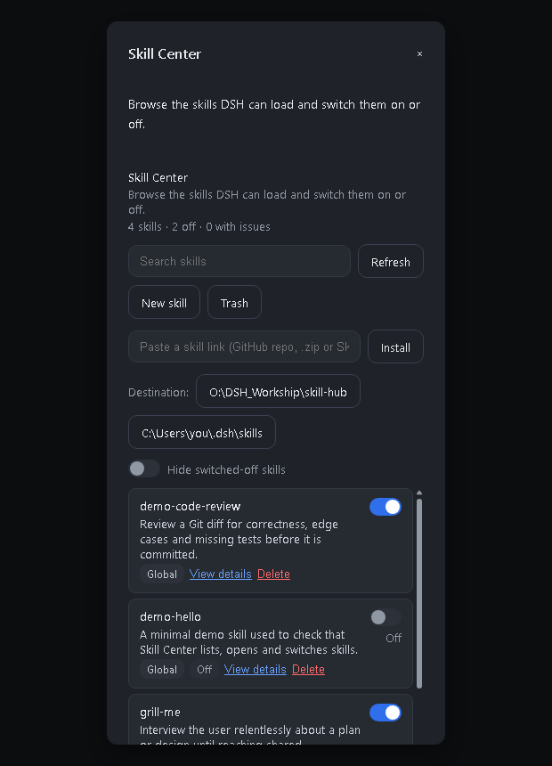
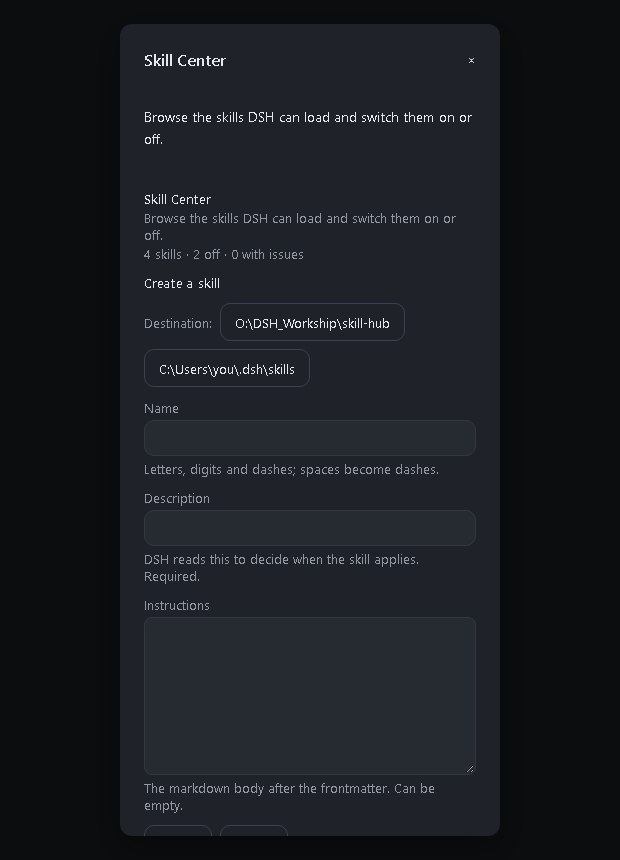
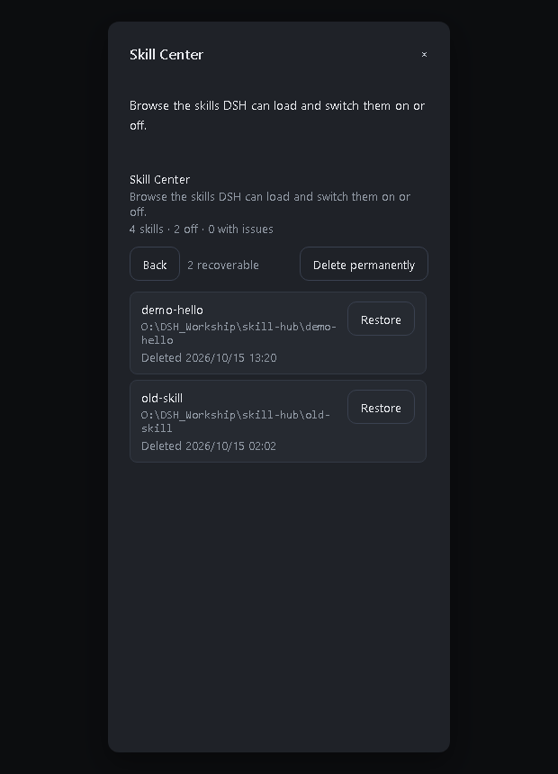
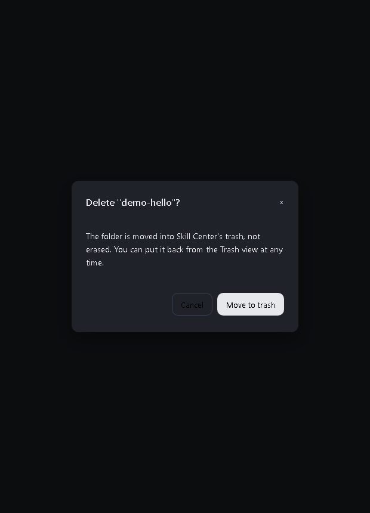
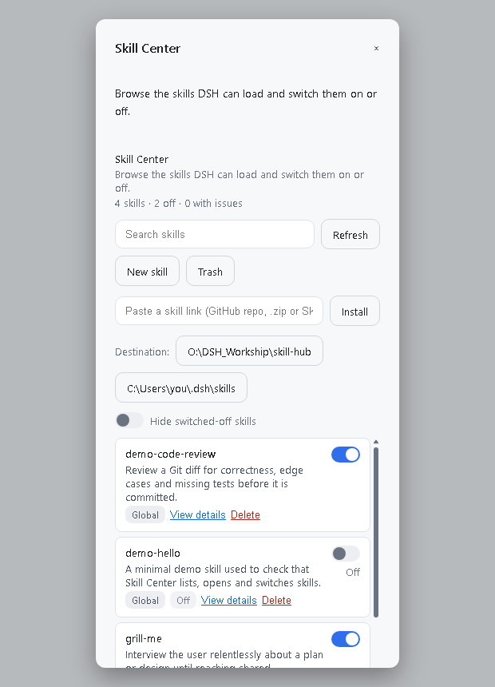

# @dsh-workship/skill-center

**Skill Center** adds one page to the DSH Web client where you can see every skill DSH can load from your own directories, read one, switch it on or off, create one, install one from a link, and delete one into a trash you can restore from.

It is a third-party DSH plugin, not an official DeepSeek product. Licensed under the [MIT License](LICENSE).



## Screenshots

| | |
| --- | --- |
|  |  |
| **The list** — every skill DSH can load, with its switch, its provenance and its problems. The row above it is where a link goes. | **Creating one** — name, description and body, written into whichever destination is selected. |
|  |  |
| **The trash** — what was deleted, where it came from, and one button to put it back. | **Deleting** — the confirmation says plainly that the skill goes to the trash, because a reversible delete is a different promise from an erase. |

The screenshots are rendered from the shipped browser bundle over the Host's own
`Modal` stylesheet, so the layout, colours and scrollbar are the ones the application
produces; only the surrounding application window is left out. `scripts/dev/render-shots.mjs`
regenerates them, in either theme.

## Where it appears

Two entry points, both opening the same page over one shared store:

- **Settings → Skill Center** — the settings section, so it sits with the rest of the configuration.
- **A `Skills` button in the composer**, in the input row beside the permission chip. It opens the page in a modal, which is the quick path for switching a skill on or off mid-task.

The composer button lives in `conversation.input.left`. That is the only composer seat a plugin may extend: the permission chip (`conversation.input.permission`) and the model picker (`conversation.input.model`) are `single` seats their own plugins already hold, so nothing can be inserted between them. The button also cannot deep-link to its settings section — `openSection` is internal to the settings shell — so it opens the page directly instead.

Both entries follow the Host's theme:



## What it does

- **Lists** the skills under `$DSH_HOME/skills` (default `~/.dsh/skills`), any directory the profile adds through `customSkillDirs`, and the current project's `<project>/.dsh/skills`.
- **Shows details** for one skill: description, path, frontmatter block and instruction body.
- **Searches** by name or description, and can hide the switched-off skills.
- **Switches a skill on or off** without losing it: everything else about the file, including your own frontmatter keys, is left alone.
- **Creates a skill** from a name, a description and a body.
- **Installs a skill from a link** — a GitHub repository, a `/tree/` path inside one, a `.zip`, or a single `SKILL.md`.
- **Deletes a skill into a trash**, and restores it from there.
- **Writes new skills where you choose** — the destination control offers every directory the profile makes available, and the host accepts nothing else.
- **Reports problems** the host would silently skip, such as a missing `description` or a name that is not kebab-case.
- Follows the Host's light or dark theme.

### Where new skills are written

The destinations come from the Host, not from the panel: `GET /roots` answers with the
profile's configured `customSkillDirs` followed by the default `$DSH_HOME/skills`. The
browser offers exactly that list, and `POST /create` and `POST /install` refuse a
directory outside it — so "choose where to write" does not become "write anywhere". With
one destination the control is a sentence; with several, each is a button, because the
path is the point.

### Where deletion is allowed to reach

Removing something the user wrote is the one destructive thing here, so it is bounded:

- **Only DSH's own skills.** The trash covers the global roots (the DSH home and any `customSkillDirs`). A project root — `<project>/.dsh/skills`, which is under version control — is never touched: Skill Center may switch such a skill on or off, but it will not move it out of a repository.
- **Only skills DSH can actually load.** A skill with broken frontmatter may have been misread, which is a reason to leave it alone rather than to move it.
- **Never through a link.** A symbolic link, or a Windows junction (which `lstat` reports as an ordinary directory), is refused by comparing the resolved path with the requested one.
- **Never a plain erase.** The bundle is moved into `~/.dsh/skill-center/trash` with a record of where it came from, and the panel can put it back byte-for-byte. Emptying the trash is a separate, confirmed action.
- **Never a half-move.** Everything is validated before anything moves, and a move that cannot be recorded is rolled back. Because `rename` cannot cross volumes, a failed move falls back to copy-then-remove — copy first, so a failure leaves the original in place.

### What installing a link will and will not do

The download is treated as hostile input: entry paths may not escape the target, a bundle must have a `SKILL.md` with a name DSH accepts and a description DSH requires, an existing name is refused rather than overwritten, and nothing is written until every one of those checks has passed. Private archives and Zip64 are refused. Links to this machine (`localhost`, `127.0.0.1`, `.local`) are not fetched, and a single download is capped at 8 MB and 800 entries.

### Which layouts are discovered

Matching the Host's own filesystem provider exactly, a skill is a directory bundle `<name>/SKILL.md` or a flat `<name>.md`, **at the top level of a skills root**. Nested `**/SKILL.md` is deliberately not discovered.

This matters when installing from a GitHub download: a repository ZIP extracts to one folder, and copying *that* folder into `~/.dsh/skills` leaves every bundle one level too deep, where neither DSH nor this panel will find it. Move the bundle folders themselves into the skills root.

## What it does not do

- No other agents' directories (Claude Code, Codex, Cursor, …).
- No Git repositories, no skill marketplace, no automatic updates.
- No creating or importing skills.
- No Trash.
- Nothing outside the two roots above is ever read or written.

## How switching a skill off works

Skill Center writes the two flags the DSH filesystem provider already understands into the skill's own frontmatter:

```yaml
---
name: my-skill
description: What it is for.
disable-model-invocation: true
user-invocable: false
---
```

Switching the skill back on removes exactly those two keys, restoring the document byte-for-byte. Because the flags live in the file:

- the state survives restarts and is visible to any other tool;
- the skill disappears from the model catalogue and the `/` menu, but stays on disk;
- an interrupted write cannot leave a half-written document — the file is replaced atomically.

A skill whose frontmatter cannot be parsed is listed with a diagnosis and its switch is disabled, so Skill Center never rewrites a document it does not understand.

## Requirements

- DeepSeek Harness with the Web client (tested against `0.2.0-rc.2`).
- Node.js `^22.19.0 || >=24.0.0`.

## Install

```powershell
git clone https://github.com/a766513648-lgtm/dsh-skill-center.git
cd dsh-skill-center
npm install
npm run verify                   # type check, build, tests
dsh plugin --profile <your-profile> add .
```

Or install a packed tarball:

```powershell
npm pack
dsh plugin --profile <your-profile> add .\dsh-workship-skill-center-0.1.0.tgz
```

Then **restart DSH** — the host half is loaded once at start-up, so a page refresh
alone is not enough — and open **Settings → Skill Center**.

> The client half is served with an immutable cache header and its URL is keyed on
> the bundle's modification time. Reinstalling the same version can therefore leave
> an old page in the browser; a hard reload (`Ctrl+Shift+R`) or a full application
> restart picks the new one up.

## Development

```
src/
  index.ts              host half: browser API + the on/off gate provider
  contract.ts           request and response shapes shared by both halves
  core/parse.ts         frontmatter reading and diagnosis
  core/scan.ts          discovery of every skill root
  core/store.ts         durable on/off state (atomic JSON)
  core/toggle.ts        the frontmatter rewrite
  core/trash.ts         delete and restore, with the guards that bound them
  core/zip.ts           a minimal ZIP reader (stored and deflated entries)
  core/install.ts       installing a skill from a URL
  client/index.ts       browser half: registers the settings page and the button
  client/store.ts       panel state and host calls
  client/SkillCenterSection.tsx   the page itself
  client/scrollStyles.ts          the list's scrollbar stylesheet
  client/locales.ts     English and Simplified Chinese copy
scripts/
  build.mjs             transpiles and bundles both halves
  test.mjs              runs the suites in one process
  dev/                  tools that are useful but not part of the build
    probe-host.mjs      mounts the host half on a stub context and reports what it calls
    probe-app.mjs       mounts the plugin on a real cordis app
    variant.mjs         swaps the browser half between its real and minimal forms
    reinstall.ps1       build, pack and install into a DSH profile in one step
    check-install.mjs   hashes the installed copy against the local build
    check-install-live.mts  installs from real public URLs, to check the world not the mocks
    run-one.mjs         runs a single `.mts` probe through the same transpiler
test/                   unit, build and end-to-end suites
variants/               the two browser-half sources `variant.mjs` swaps between
```

`lib/` is generated; run `npm run build` after changing `src/`.

`.npmrc` is machine-specific and not committed; `.npmrc.example` explains what it
holds and when it is needed.

### Contributing to other plugins' slots

`settings.section` and `conversation.input.left` are declared by other plugins, not by this one. Calling `slots.register` directly races the declarer: whichever plugin activates first throws `slot "settings.section" is not declared (a parent entry's children table must declare it)`. The failure is intermittent — it depends on activation order — and the client plugin loader reports it only as `<name>: failed`, with the reason going to the browser console. Always go through `slots.inject`, which waits for the declaration, re-runs on change and tears the contribution down when the declarer goes away:

```ts
ctx.slots.inject('settings.section', () =>
  ctx.slots.register({ name: 'settings.section', id: 'skill-center', /* … */ }, SkillCenterSection),
);
```

The failure is intermittent, which is the worst part: when this plugin happened to
activate after the shell it worked, and the client plugin loader reports a failed
entry only as `<name>: failed` with no reason — the reason goes to the browser
console. Two safeguards now catch it:

- the browser half is **defensive**: every step is guarded and a failure is POSTed
  to `/api/skill-center/client-report`, which writes it to the host's stderr, so
  the desktop log shows the real message;
- `test/clientBundle.test.mts` asserts the contribution goes through
  `slots.inject`, and its `slots` stub does not run the callback eagerly — an
  eager stub would hide exactly this race.

### Diagnosing a plugin that will not activate

A plugin that fails to load leaves almost no trace: the desktop reports *"N entries did not activate"* with only `<name>: failed`, and the full reason never reaches the log. These tools answer it:

```powershell
node scripts/probe-host.mjs <path-to-lib/index.js>   # does apply() throw, and what does it call?
node scripts/probe-app.mjs  <path-to-lib/index.js>   # does the plugin mount on a real cordis app?
node scripts/variant.mjs minimal                     # swap in a throwaway page that only reports whether it loaded
```

`probe-host.mjs` catches API misuse; `probe-app.mjs` catches module-shape and mount-semantics problems; the `minimal` variant separates "the client module machinery cannot load this bundle" from "the page itself fails". `variants/` holds both browser halves and `scripts/reinstall.ps1 -Variant minimal` builds, packs and installs one.

### Why the build does not use a bundler

The development sandbox refuses `spawn` with piped stdio, which is how esbuild's JavaScript API starts its native service. The build therefore uses the TypeScript compiler in process, transpiling each module to CommonJS and emitting:

- `lib/index.js` — one CommonJS file for the host, with `lib/package.json` marking the folder so the package's own `"type": "module"` does not make Node parse it as ESM;
- `lib/client.js` — one lazy factory in the Web client's module-system format, with an internal module table and Host-shared libraries resolved through the shell's import map.

### Two rules the artifacts must obey

Both were learned the hard way and both are enforced by `test/build.test.mts`:

1. **No runtime `require` of a Host package.** The plugin is installed on its own, so the Host's packages are not on its resolution path. A single side-effect `import '@deepseek-ai/dsh-host-webserver'`, added only for its type augmentation, survives bundling and makes the whole plugin fail to import — Settings then shows no page at all. Imports that exist only for types must be `import type`, which TypeScript erases.
2. **Only libraries declared in `dsh.client.external` may be required by the browser half.** Anything else either gets bundled (a second copy of React, which breaks hooks) or resolves to `undefined`.

### Logging

The host half writes **one line to stderr when it starts**, and otherwise only when something fails (with the stack). That single line is the point: the Loader reports a plugin that fails to activate as `<name>: failed` and nothing else, so without it a broken mount is invisible. The browser half reports its own failures to the host over `/api/skill-center/client-report`, which reaches the same log; it says nothing when it succeeds.


## License

MIT.
